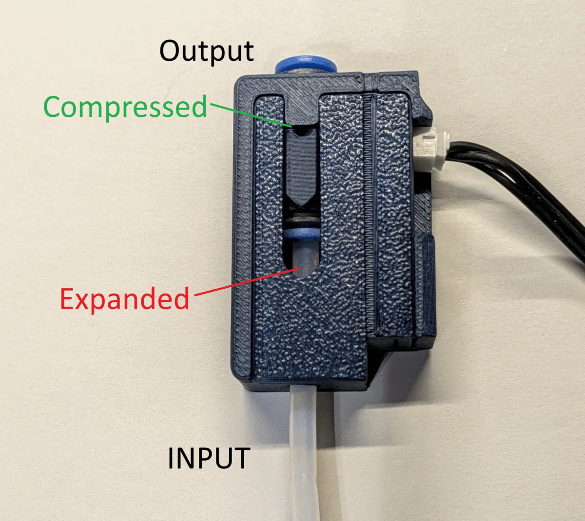
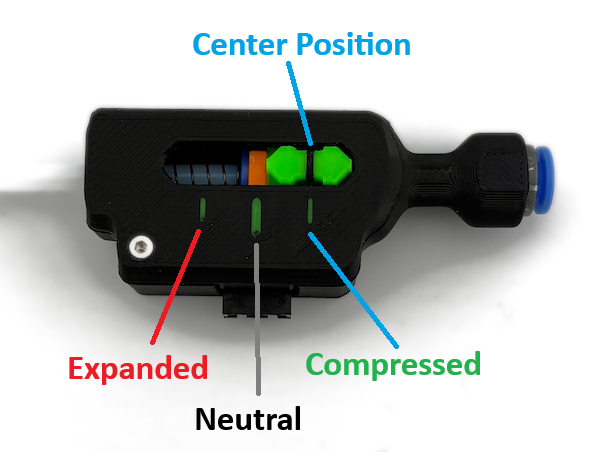
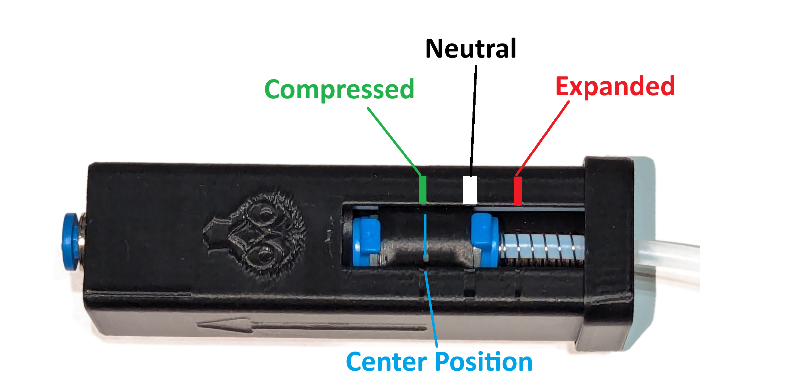

# Buffer Module Overview

## Supported Buffers

The `AFC_buffer` module is responsible for handling the buffer, currently supported buffers are the following: 

- Any double-switched based buffer involving two sensors(advance and trailing):  
    - [TurtleNeck](https://github.com/ArmoredTurtle/TurtleNeck)
    - [TurtleNeck 2.0/Pro](https://github.com/ArmoredTurtle/TurtleNeck2.0)  
- Compensator by [ArmoredTurtle](https://github.com/ArmoredTurtle/Compensator)
- TurtleNeck 2 Remastered by [ArmoredTurtle](https://embeds.daedum.com/manual.html?manual=9c00071b-3bf3-4d16-b1be-1044af001a48)
- Proportional Sync Feedback (PSF) sensor by [kashine6](https://github.com/kashine6/Proportional-Sync-Feedback-Sensor)
- Filament Pressure Sensor (FPS) for [OpenAMS project](https://github.com/OpenAMSOrg/filament-buffer)

The buffer adjusts rotation distance for active Box Turtle extruder(lane) based on sensor inputs.

## Basic Functionality

The AFC buffer is designed to work with two extruder filament control systems. The primary extruder is at the print 
head(s) and the second is in the AFC unit. While the 2 extruders are synced they will never be perfect. This is where 
a buffer comes in. The buffer is used to make up for any inconsistencies in the sync between the 2 stepper motors.

=== "TurtleNeck Style buffer"
    Two sensor TurtleNeck-style buffers are used to modulate the rotation distance of the secondary extruder. 
    The buffer's expansion or compression increases or decreases the rotation distance. 

    * If the `trailing` sensor is triggered, this means that the buffer is compressed, the AFC will decrease rotation 
    distance in order to move the filament quicker to the primary extruder. When this `trailing` sensor is triggered, the system
    goes into an `advancing` state and the buffer starts to expand.

    * If the `advance` sensor is triggered, this means that the buffer is expanded, the AFC will increase rotation 
    distance in order to slow the filament moving to the primary extruder. When this `advanced` sensor is triggered, the system
    goes into a `trailing` state and the buffer starts to compress.

    ### Turtleneck 1.0

    


    ### TurtleNeck 2.0

    [__Flashing TurtleNeck 2.0__](https://github.com/ArmoredTurtle/TurtleNeck2.0/blob/main/Flashing/README.md)

    

=== "Compensator"
    Compensator is a dual-sensor PCB for a linear filament buffer. It tracks the position of a moving magnet and combines the readings from two Hall sensors into one analog signal that a controller can monitor through a single ADC input. This sensor outputs a voltage from 0 (compressed) to 1 (expanded). With this sensor the approach is to try and keep the buffer at 0.5 (Neutral), as this will help detect clogs/incorrect feeding faster.

    The board also exposes both individual Hall sensor outputs for applications that need access to the uncombined signals.
    The Compensator uses an analog pin (ADC) to read voltage from its dual Hall-effect sensors with a magnet passing over them.  

    Below is a picture of the compressed/expanded states, along with how filament should move through the sensor. Output should be facing towards the toolhead.  

     

    More information about Compensator and STL files can be found on [ArmoredTurtle's GitHub](https://github.com/ArmoredTurtle/Compensator) page.

=== "Proportional Sync Feedback (PSF) sensor"
    The PSF uses an analog pin (ADC) to read voltage from a hall effect sensor with a magnet passing over it. This sensor outputs
    a voltage from 0 (compressed) to 1 (expanded). With this sensor the approach is try and keep the buffer at 0.5(Neutral) as this 
    will help detect clogs/incorrect feeding faster.

    For more information about this sensor, see the [Proportional-Sync-Feedback-Sensor](https://github.com/kashine6/Proportional-Sync-Feedback-Sensor) github repository.  

    Links to PSF designs to hold the sensor with image of where the different states are at:    

    - [Stumpy_PSF_Sensor](https://github.com/ningpj/Stumpy_PSF_Sensor) by Ningpj
    
       

    - [PSF for EMU](https://github.com/DW-Tas/EMU/tree/main/STL/Tension-compression-sensor/Proportional%20Sync%20Feedback%20(PSF)%20Version) by DW-Tas
    
    

## Configuration

### Required AFC Hardware Configuration Options

In your AFC hardware configuration file, ensure you include the following options:

=== "TurtleNeck Style buffer"
    - `advance_pin`: Pin for the advance sensor.
    - `trailing_pin`: Pin for the trailing sensor.

    Optional for more fine-tuning:

    - `multiplier_high`: Factor to move more filament through the secondary extruder.
    - `multiplier_low`: Factor to move less filament through the secondary extruder.

    ### TurtleNeck 2.0 LED Indicator Configuration

    Add to `AFC_hardware.cfg` file:

    ```cfg
    [AFC_led Buffer_Indicator]
    pin: TN:PD3
    chain_count: 1
    color_order: GRBW
    initial_RED: 0.0
    initial_GREEN: 0.0
    initial_BLUE: 0.0
    initial_WHITE: 0.0
    ```

    ### Optional AFC.cfg LED settings

    ```cfg
    led_buffer_advancing: 0,0,1,0
    led_buffer_trailing: 0,1,0,0
    led_buffer_disable: 0,0,0,0.25
    ```

    ### Example Configs

    ```cfg
    [AFC_buffer Turtle_1]
    advance_pin:     # set advance pin
    trailing_pin:    # set trailing pin
    multiplier_high: 1.05   # default 1.05, factor to feed more filament
    multiplier_low:  0.95   # default 0.95, factor to feed less filament

    [AFC_buffer TN2]
    advance_pin: !turtleneck:ADVANCE
    trailing_pin: !turtleneck:TRAILING
    multiplier_high: 1.05   # default 1.05, factor to feed more filament
    multiplier_low:  0.95   # default 0.95, factor to feed less filament
    led_index: Buffer_Indicator:1
    ```
    See [switched buffer configuration](../configuration/AFC_Hardware.cfg.md#afc_buffer-buffer_name-section-switch-type) for more configuration values.

=== "TurtleNeck 2 Remastered"

    Add the following to your AFC_Hardware.cfg or config file for the unit you are adding your TN2R sensor to.

    ```cfg
    [AFC_buffer ${unit_name}]
    type: FPS_PSF
    adc_pin: TN2R:PSF
    neutral_point: 0.5
    max_tension: 0.1
    max_compression: 0.9
    reversed: True
    led_index: ${unit_name}_Buffer_Indicator:1

    [AFC_led ${unit_name}_Buffer_Indicator]
    pin: TN2R:RGB
    chain_count: 1
    color_order: GRBW
    initial_RED: 0.0
    initial_GREEN: 0.0
    initial_BLUE: 0.0
    initial_WHITE: 0.0
    ```

    See [Comp/FPS/PSF buffer configuration](../configuration/AFC_Hardware.cfg.md#afc_buffer-buffer_name-section-compfps_psf-type) for more configuration values.

    ### Testing sensor
    Once klipper is started, while looking at the sensor in your Fluidd/Mainsail UI move the buffer until its in the "compressed" position. Verify that the TN2R compressed sensor shows as detected. If expanded is being detected, flip the `reversed` variable (set it to `True/False`, whichever is the inverse of what it's currently set to). Restart klipper and verify that compressed is detected when moving to the compressed position, expanded is detected when in the expanded position and expanded/compressed sensors don't detect when in neutral position.

=== "Compensator"
    Add the following to your AFC_Hardware.cfg or config file for the unit you are adding your Compensator sensor to, and update `adc_pin` to the correct MCU pin.  

    `adc_pin`: MCU ADC pin that the Compensator signal is connected to
    ```cfg
    [AFC_buffer COMP_buffer1]
    type: COMP
    adc_pin: Turtle_1:PC4
    neutral_point: 0.5
    low_point: 0.2
    high_point: 0.8
    deadband: 0.25
    reversed: false    #Test slide by hand and look at buffer state in mainsail/fluidd Set to true if display shows opposite of your tested state.
    adc_min_val: 0.0
    adc_max_val: 1.0
    ```

    See [Comp/FPS/PSF buffer configuration](../configuration/AFC_Hardware.cfg.md#afc_buffer-buffer_name-section-compfps_psf-type) for more configuration values.

    !!! note
        If your sensor's raw ADC output doesn't span the full 0.0-1.0 range, set `adc_min_val`/`adc_max_val` to scale the raw reading into that range. See [Comp/FPS/PSF buffer configuration](../configuration/AFC_Hardware.cfg.md#afc_buffer-buffer_name-section-compfps_psf-type) for details. `QUERY_BUFFER` reports the raw, prescaled ADC value alongside the scaled reading.

    ### Testing sensor
    Once klipper is started, while looking at the sensor in your Fluidd/Mainsail UI move the buffer until its in the "compressed" position. Verify that the Compensator compressed sensor shows as detected. If expanded is being detected, flip the `reversed` variable (set it to `True/False`, whichever is the inverse of what it's currently set to). Restart klipper and verify that compressed is detected when moving to the compressed position, expanded is detected when in the expanded position and expanded/compressed sensors don't detect when in neutral position.

=== "PSF Sensor"
    Add the following to your AFC_Hardware.cfg or config file for the unit you are adding your PSF sensor to, and update `adc_pin` to the correct MCU pin.

    `adc_pin`: MCU ADC pin that the PSF signal is connected to  
    ``` cfg
    [AFC_buffer PSF_buffer1]
    type: FPS_PSF
    adc_pin: PA0
    neutral_point: 0.5
    max_tension: 0.1
    max_compression: 0.9
    reversed: false  #Test slide by hand and look at buffer state in mainsail/fluidd Set to true if display shows opposite of your tested state.
    ```

    See [Comp/FPS/PSF buffer configuration](../configuration/AFC_Hardware.cfg.md#afc_buffer-buffer_name-section-compfps_psf-type) for more configuration values.

    !!! note
        If your sensor's raw ADC output doesn't span the full 0.0-1.0 range, set `adc_min_val`/`adc_max_val` to scale the raw reading into that range. See [FPS/PSF buffer configuration](../configuration/AFC_Hardware.cfg.md#afc_buffer-buffer_name-section-compfps_psf-type) for details. `QUERY_BUFFER` reports the raw, prescaled ADC value alongside the scaled reading.

    ### Testing sensor
    Once klipper is started, while looking at the sensor in your Fluidd/Mainsail UI move the buffer until its in the "compressed" position. Verify that the PSF compressed sensor shows as detected. If expanded is being detected, flip the `reversed` variable (set it to `True/False`, whichever is the inverse of what it's currently set to). Restart klipper and verify that compressed is detected when moving to the compressed position, expanded is detected when in the expanded position and expanded/compressed sensors don't detect when in neutral position.

=== "FPS Sensor"

    Add/verify the following is in you OpenAMS configuration file.
    ``` cfg
    [AFC_buffer FPS_buffer1]
    type: FPS_PSF
    adc_pin: fps:PA2
    reversed: false #Test slide by hand and look at buffer state in mainsail/fluidd Set to true if display shows opposite of your tested state.
    set_point: 0.5
    filament_error_sensitivity: 3.0  # 0-10 scale, 0 disables
    multiplier_high: 1.15
    multiplier_low: 0.85
    ```

    See [Comp/FPS/PSF buffer configuration](../configuration/AFC_Hardware.cfg.md#afc_buffer-buffer_name-section-compfps_psf-type) for more configuration values.

    ### Testing sensor
    Once klipper is started, while looking at the sensor in your Fluidd/Mainsail UI move the buffer until its in the "compressed" position. Verify that the FPS compressed sensor shows as detected. If expanded is being detected, flip the `reversed` variable (set it to `True/False`, whichever is the inverse of what it's currently set to). Restart klipper and verify that compressed is detected when moving to the compressed position, expanded is detected when in the expanded position and expanded/compressed sensors don't detect when in neutral position.

## Buffer Fault Detection
!!! warning "Experimental"

    This feature is still experimental and you still may run into false detections during initial purging/first layer
    when starting a print.

AFC can detect filament faults during printing by monitoring extruder position and buffer state changes.
This feature helps identify clogs, jams, and feeding issues before they result in failed prints.

The fault detection system monitors how far the extruder has moved relative to buffer switch activations.
If the extruder travels beyond a configured threshold distance and the buffer fails to respond appropriately, 
AFC will pause the print and provide diagnostic information about the issue.

Fault detection uses a configurable sensitivity scale from 0-10, where:

- `0` disables fault detection completely
- `1` is the least sensitive (allows 100mm of movement before triggering)
- `10` is the most sensitive (triggers after only 10mm of movement)
The formula used is: `fault_distance = (11 - sensitivity) × 10`

When a fault is detected, AFC provides contextual error messages based on the buffer state:

- If the buffer is in the Advancing state (expanding), the message indicates a potential CLOG DETECTED
- If the buffer is in the Trailing state (compressing), the message indicates AFC NOT FEEDING

To enable fault detection, add the `filament_error_sensitivity` parameter to your `[AFC_buffer <buffer_name>]` section:
```
[AFC_buffer TN]
advance_pin: <pin>
trailing_pin: <pin>
filament_error_sensitivity: 5.0  # 0-10 scale, 0 disables
multiplier_high: 1.1
multiplier_low: 0.9
```
The sensitivity can be adjusted during runtime without restarting Klipper using the `AFC_SET_ERROR_SENSITIVITY` command:
`AFC_SET_ERROR_SENSITIVITY BUFFER=TN SENSITIVITY=7.0`


## Off-Nominal Buffer Configurations
Buffers can also be set per Unit/Stepper. If multiple lanes use the same buffer for one Unit then the buffer can just 
be added to Unit config (`AFC_BoxTurtle`, `AFC_NightOwl`, etc.). If a buffer is inputted into the `AFC_stepper` 
config then this will override whatever is set at the Unit level.

### Example

Setting buffer for a single unit
```cfg
[AFC_BoxTurtle Turtle_1]
buffer: Turtle_1
```
Overriding buffer at stepper:
```cfg
[AFC_stepper lane1]
unit: Turtle_1:1
buffer: Turtle_1
<rest of config>
```

## AFC buffer commands

### QUERY BUFFER

The `QUERY_BUFFER` command reports the current state of the buffer and, if applicable, the rotation distance 
of the AFC stepper motor. 

Example usage:
`QUERY_BUFFER BUFFER=Turtle_1`

Example outputs:

- `Turtle_1: Trailing (buffer is compressing)` - buffer is moving from the Advance trigger to the Trailing.
- `Turtle_1: Advancing (buffer is expanding)` - buffer is moving from the Trailing trigger to the Advance. 

### SET_ROTATION_FACTOR
_For TurtleNeck Style Buffers_

This command allows the adjustment of rotation distance of the current AFC stepper motor by applying a factor. Factors 
greater than 1 will increase the rate filament is fed to the primary extruder, factors less than 1 but greater than 0 
will decrease the rate filament to the primary extruder.

Example Usage:
`SET_ROTATION_FACTOR BUFFER=Turtle_1 FACTOR=1.1`

### SET_BUFFER_MULTIPLIER
_For TurtleNeck Style Buffers_

`SET_BUFFER_MULTIPLIER` used to live adjust the high and low multipliers for the buffer
- To change `multiplier_high`: `SET_BUFFER_MULTIPLIER BUFFER=Turtle_1 MULTIPLIER=HIGH FACTOR=1.2`
- To change `multiplier_low`: `SET_BUFFER_MULTIPLIER BUFFER=Turtle_1 MULTIPLIER=LOW FACTOR=0.8`
    
!!! note
    Buffer config section must be updated for values to be saved
