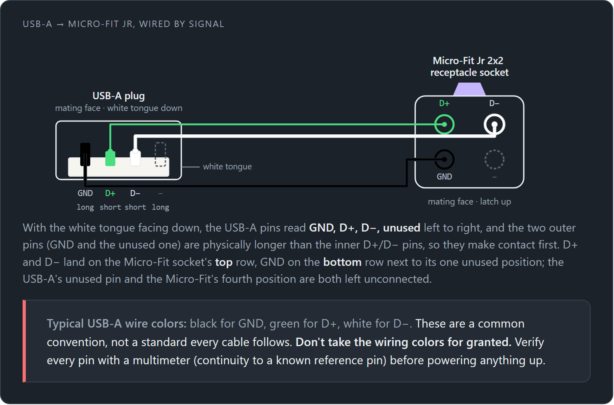
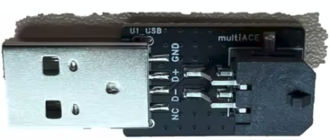
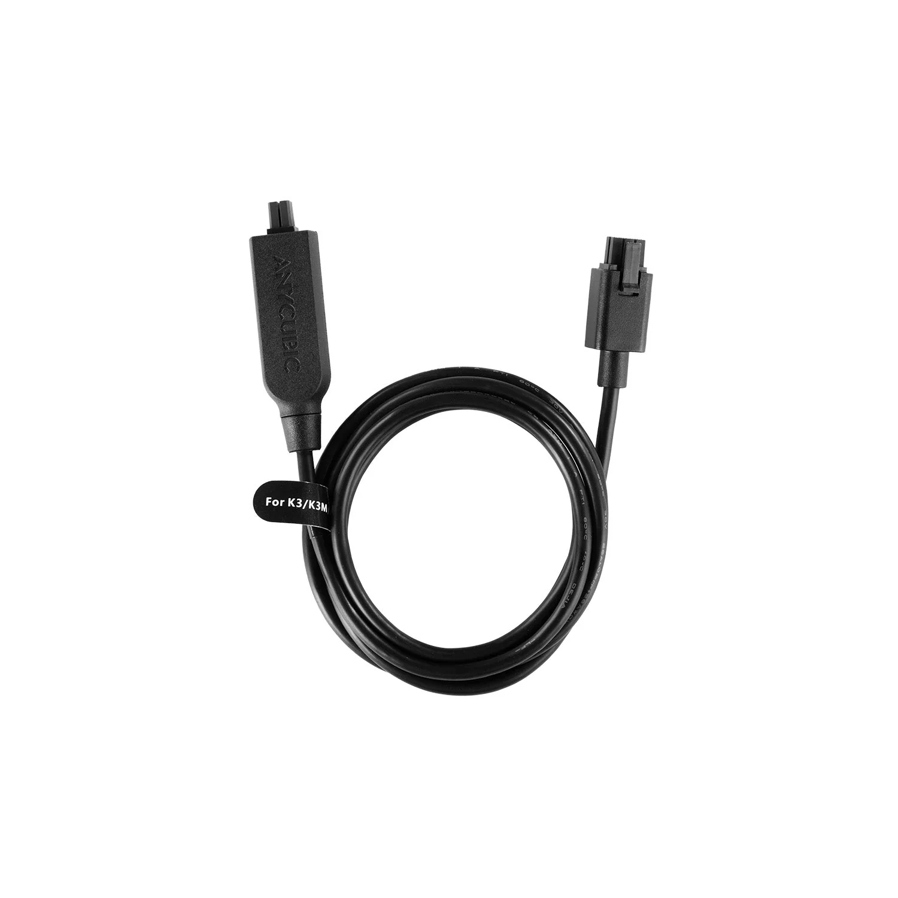

# Initial Startup & Commissioning Guide

The following guide will help you on the journey to multicolor printing after you have physically completed
the assembly of your Automatic Filament Changer (AFC) unit. Throughout this initial startup section, make sure to select
the appropriate unit type (e.g. Boxturtle, HTLF, etc.).

=== "BoxTurtle"

    [BoxTurtle Assembly Manual](https://armoredturtle.org/manual-sections.html?manual=boxturtle)

    --8<-- "includes/prerequisites.md"

=== "NightOwl"

    [NightOwl Assembly Manual](https://github.com/mjonuschat/NightOwl/tree/main/Manual)

    --8<-- "includes/prerequisites.md"

=== "HTLF"

    [HTLF Assembly Manual](https://armoredturtle.org/manual-sections.html?manual=htlf)

    --8<-- "includes/prerequisites.md"

=== "ViViD"

    [ViViD Manual](https://github.com/bigtreetech/BIGTREETECH_ViViD/blob/master/BIGTREETECH_ViViD_User_Manual%20V1.0.2.pdf)

    !!!warning
        If you are running Kalico, at least version v2026.06.00 needs to be installed to use ViViD's heater temperature sensor

    --8<-- "includes/prerequisites.md"

=== "EMU"
    [EMU docs](https://github.com/DW-Tas/EMU/tree/main/docs)  
    [EMU manuals](https://github.com/DW-Tas/EMU/tree/main/Manuals)

    --8<-- "includes/prerequisites.md"

=== "Snapmaker U1"
    --8<-- "includes/u1/need_to_install_extended_fw.md"

    AFC-Klipper-Add-On has been included into [Snapmaker U1 Extended Firmware](https://github.com/paxx12-snapmaker-u1/SnapmakerU1-Extended-Firmware) provided by AFC team, this initial guide walks you through uploading the extended firmware and enabling a basic AFC config that operates all four toolheads in standalone mode([click here](../toolchanger/overview.md#toolchanger-overview) to learn more about what a standalone toolhead means for toolchangers).

    After installing the extended firmware and enabling full AFC-Klipper-Add-On, if you would like to add a BoxTurtle or any other automated filament changer to your U1, then revisit this initial startup guide for the appropriate filament changer.

    ## A couple of notes when using automated filament changer on U1
    - If you add a filament changer to your U1 you will need to use the [u1-klipper](https://github.com/Snapmaker/u1-klipper) firmware version when flashing your MCU. If this is not done then your filament changer MCU and U1-klipper firmware will not communicate correctly and will error out.
    - [Buffer ramming](../installation/buffer-ram-sensor.md) needs to be enabled for detecting when filament has reached the toolhead.

    Before installing and enabling AFC-Klipper-Add-On onto your U1, please take a second to [read](../toolchanger/snapmaker.md) over what U1 functions currently work and what functions do not work correctly when using AFC-Klipper-Add-On on your U1. 

    [Next step](03-install-plugin.md#snapmaker-u1)

=== "ACE Pro 1/2"

    ## Custom Cable

    Before starting, a custom cable needs to be made for the ACE Pro 1/2 printers. This can easily be done by using an
    old USB Type-A to USB Type-B (who uses these anymore?) cable and cutting off the USB Type-B end. Then the cut end
    needs to be wired like the diagram below to a Molex Micro-Fit Jr. receptacle connector
    ([Amazon link for kit](https://www.amazon.com/dp/B0DRHJQSTX)).

    

    ## Premade Adapter
    If you don't want to create your own cable, premade adapters can also be found on AliExpress. A link is not
    provided here since AliExpress listings can change over time, but searching for something like "USB to Molex
    Adapter for Snapmaker U1 and multiACE-Compatible with ACE Pro" should turn up matching results. The adapter
    looks like the photo below.

    {: .center-image }

    ## ACE Pro 2 USB to RS485 Cable

    For the ACE Pro 2, your custom cable needs to be connected to the ACE 2 Pro USB to RS485 Signal Cable, which looks
    like the following below. If this cable did not come with your ACE 2 Pro, it can be acquired from
    [Anycubic's site](https://store.anycubic.com/products/usb-to-rs485-signal-cable).

    

    !!! note
        AFC provides an optional custom firmware for the ACE Pro 2 that lets it move filament faster and adds RFID
        passthrough support (not yet used by AFC, planned for a future release). See the "ACE Pro 1/2" tab on the
        [Flashing](02-flashing.md) page for details.

    ## Connect

    ### Cable
    Once your custom cable has been made, connect it to your ACE unit:

    - For ACE Pro, connect the custom cable onto the 4-pin end of the 6-to-4-pin connection cable.
    - For ACE Pro 2, connect the custom cable into the 4-pin end of the USB to RS485 cable.

    ### PTFE Tubes
    - If all lanes are going to a single toolhead, connect all lanes to the hub and note the length of each of your
      PTFE running to your hub (make them all the same length if possible), then connect the hub to your toolhead.

    - Currently this guide does not cover in depth connecting lanes to different toolheads. Please see the
      [toolchanger docs](../toolchanger/overview.md) to learn about the different configurations.

    Once this is done you can proceed to the next step for installing AFC onto your machine.

    --8<-- "includes/prerequisites.md"

    [Next step](03-install-plugin.md)
