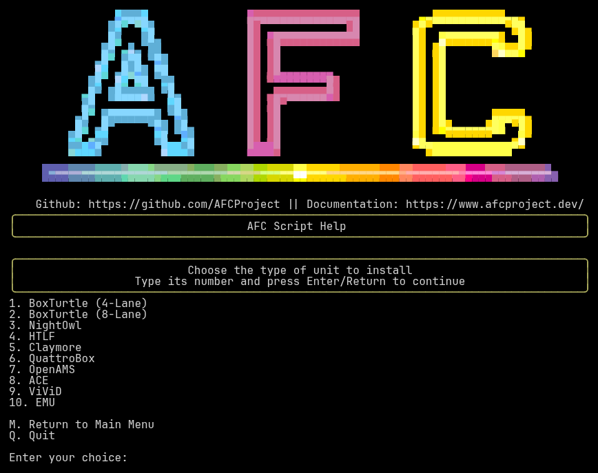
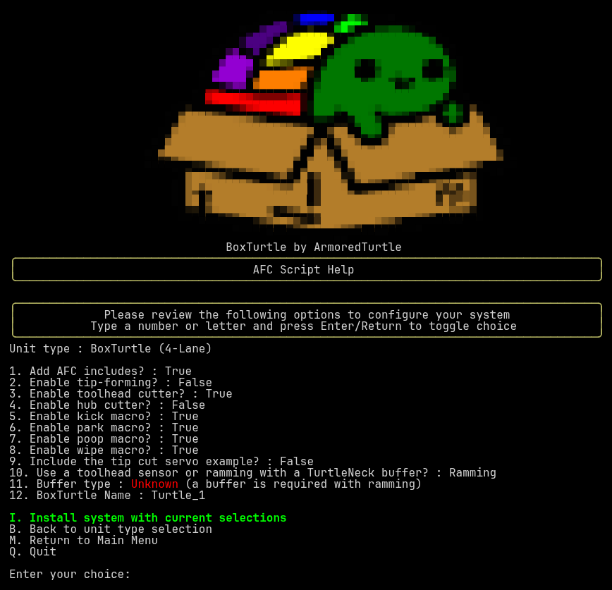

### Menu Overview

Selecting `I. Install New System` from the [main menu](main-menu.md) walks you through two screens:

1. **Unit type selection** - choose the type of unit you are installing.
2. **Install options** - review and adjust the options for that unit type, then install.

### Step 1: Choose your unit type

The unit type screen shows a numbered list. Type the number of your unit and press Enter. The currently available
options are:

| Number | Unit type            |
|--------|----------------------|
| 1      | BoxTurtle (4-Lane)   |
| 2      | BoxTurtle (8-Lane)   |
| 3      | NightOwl             |
| 4      | HTLF                 |
| 5      | Claymore             |
| 6      | QuattroBox           |
| 7      | OpenAMS              |
| 8      | ACE                  |
| 9      | ViViD                |
| 10     | EMU                  |

{ loading=lazy }

You can also enter `M` to return to the main menu or `Q` to exit.

### Step 2: Install options

{ loading=lazy }

The `Installation` options screen is used for the initial configuration of your system. The top of the screen shows the
unit type you chose, followed by a numbered list of options. Type an option's number and press Enter to change it. Yes/No
options flip between `True` and `False`, and options with a list of choices step to the next choice each time you select them.
A short message at the top of the screen confirms the change you made.

{ loading=lazy }

??? tip "The option numbers depend on your unit type"

    Options 1 through 9 below are always the same. After those, the options that are shown depend on the unit type and on
    your other choices, so the numbers can differ from system to system. Always select an option by the number shown on your
    screen rather than from memory.

#### Options available for every unit type

##### `1. Add AFC includes?`

This boolean is used to automatically add the necessary `[include AFC/*.cfg]` to your `printer.cfg` file. This 
defaults to *true* and is recommended to be left as such.

##### `2. Enable tip-forming?`

=== "Description"
    This boolean is used to enable or disable the tip-forming functions. This defaults to *false* as the recommended 
    setup is to use a toolhead cutter and tip-forming may be unnecessary. If tip-forming is enabled, ensure that the 
    options in the `~/printer_data/config/AFC/AFC.cfg` file are set correctly.
=== "Configuration"
    Once set, this option can be changed via editing the `AFC.cfg` file typically located in the 
    `~/printer_data/config/AFC` directory.

##### `3. Enable toolhead cutter?`

=== "Description"
    This boolean is used to enable or disable the toolhead cutter. This defaults to *true* as the recommended setup 
    is to use a toolhead cutter. If the toolhead cutter is enabled, ensure that the options in the 
    `~/printer_data/config/AFC/AFC.cfg` file are set correctly.
=== "Configuration"
    Once set, this option can be changed via editing the `AFC.cfg` file typically located in the 
    `~/printer_data/config/AFC` directory.

##### `4. Enable hub cutter?`

=== "Description"
    This boolean is used to enable or disable the hub cutter. Hub cutters are a remote filament cutter not 
    co-located with the toolhead. Examples of this include user mods such as `Snappy` and other EREC based mods. This 
    defaults to *false* as the recommended setup is to use a toolhead cutter. If the hub cutter is enabled, ensure that 
    the options in the `~/printer_data/config/AFC/AFC_<unit_type>.cfg` file are set correctly in the `[AFC_hub <hub>]`
     section. 
=== "Configuration"
    Once set, this option can be changed via editing the `AFC_<unit_type>.cfg` file typically located in the 
    `~/printer_data/config/AFC` directory. These changes should be made in the `[AFC_hub <hub>]` section.

##### `5. Enable kick macro?`

=== "Description"
    This boolean is used to enable or disable the kick macro. This defaults to *true*. If the kick macro is enabled, 
    ensure that the options in the `~/printer_data/config/AFC/AFC_Macro_Vars.cfg` file are set correctly.
=== "Configuration"
    Once set, this option can be changed via editing the `AFC.cfg` file typically located in the 
    `~/printer_data/config/AFC` directory. Variables for this macro are located in the `AFC_Macro_Vars.cfg` file.

##### `6. Enable park macro?`

=== "Description"
    This boolean is used to enable or disable the park macro. This defaults to *true*. If the park macro is enabled, 
    ensure that the options in the `~/printer_data/config/AFC/AFC_Macro_Vars.cfg` file are set correctly.
=== "Configuration"
    Once set, this option can be changed via editing the `AFC.cfg` file typically located in the 
    `~/printer_data/config/AFC` directory. Variables for this macro are located in the `AFC_Macro_Vars.cfg` file.

##### `7. Enable poop macro?`

=== "Description"
    This boolean is used to enable or disable the poop macro. This defaults to *true*. If the poop macro is enabled, 
    ensure that the options in the `~/printer_data/config/AFC/AFC_Macro_Vars.cfg` file are set correctly.
=== "Configuration"
    Once set, this option can be changed via editing the `AFC.cfg` file typically located in the 
    `~/printer_data/config/AFC` directory. Variables for this macro are located in the `AFC_Macro_Vars.cfg` file.

##### `8. Enable wipe macro?`

=== "Description"
    This boolean is used to enable or disable the wipe macro. This defaults to *true*. If the wipe macro is enabled, 
    ensure that the options in the `~/printer_data/config/AFC/AFC_Macro_Vars.cfg` file are set correctly.
=== "Configuration"
    Once set, this option can be changed via editing the `AFC.cfg` file typically located in the 
    `~/printer_data/config/AFC` directory. Variables for this macro are located in the `AFC_Macro_Vars.cfg` file.

##### `9. Include the tip cut servo example?`

=== "Description"
    This boolean controls whether the tip cut servo example is kept in your `AFC_Hardware.cfg` file. This defaults to
    *false*, which means the example section is removed from the file during installation. Enable this only if you plan
    to use a servo based tip cutter.

#### Options that depend on your unit type

The following options appear after option 9, in this order, when they apply to the unit type you chose.

##### `Use a toolhead sensor or ramming with <hardware>?`

=== "Description"
    This option is used to select between using a toolhead filament sensor, or ramming with a filament buffer such as
    `Turtleneck` or `Turtleneck Pro`. The installer defaults to *Ramming*. The text of the option names the hardware used
    for ramming for your unit type (for example, an FPS board for OpenAMS).

???+ note
    This option is not shown for ACE units, which always use a toolhead sensor.

##### `Buffer type`

=== "Description"
    This option is used to select the buffer type that you are using. Each time you select it, it steps to the next of:

    - TurtleNeck
    - TurtleNeckV2 (Pro)
    - TurtleNeck 2 Remastered
    - Proportional Sync-Feedback (PSF)
    - None (only available when using a toolhead sensor)

    ACE units are the exception. Their list also includes `Internal buffer` (the default for ACE), and the cycle runs
    Internal buffer, the TurtleNeck and PSF options above, then `None`.

???+ warning
    The use of a filament buffer is *HIGHLY* recommended. If you are not using a buffer, select `None`.

    A buffer is required when the toolhead sensor option is set to *Ramming*. The installer will not start the installation
    until you choose one, and the buffer row is shown in red with a reminder until you do.

???+ note
    This option is not shown for OpenAMS and ViViD units, where the buffer follows your choice of toolhead sensor or ramming.

##### Unit specific options

Some unit types have additional options that appear here. Make sure these are set correctly for your hardware:

| Unit type          | Options                                                                                       |
|--------------------|-----------------------------------------------------------------------------------------------|
| BoxTurtle          | BoxTurtle Name                                                                                |
| NightOwl           | NightOwl Board Type (`ERB_2.0`, `OWLFC_Mini`)                                                 |
| HTLF               | HTLF Name, HTLF Board Type (`ERB`, `MMB_1.1`, `MMB_1.0`)                                      |
| Claymore           | Claymore Name, Claymore Board Type (`AFC_Lite`)                                               |
| QuattroBox         | QuattroBox Board Type (`MMB_1.0`, `MMB_1.1`, `MMB_2.0`), QuattroBox Motor Type (`NEMA_17`, `NEMA_14`) |
| ACE                | ACE Unit Type (`V1`, `V2_Pro`)                                                                |
| EMU                | EMU Name, EMU Lane Count (1 to 8), EMU Board Type (`EBB`, `SLB`)                              |
| OpenAMS, ViViD     | None                                                                                          |

Selecting a name option will prompt you for a name. The name may only contain the characters `a-z`, `A-Z`, `0-9`, `-`, and
`_`, and must be no more than 24 characters long. Leaving the answer blank uses the default name for the unit type.

##### `Extruder unit will be connected to`

=== "Description"
    This option is only shown if the installer finds more than one extruder in your printer configuration (for example a
    multi-toolhead printer). Each time you select it, it steps through the extruders it found so that you can choose which
    extruder this unit is connected to.

##### `Toolhead sensor pin`

=== "Description"
    This option is only shown when the toolhead sensor option above is set to *Sensor*, and it is always the last numbered
    option. It is used to select the pin that the toolhead sensor is connected to. This pin refers to the 
    `pin_tool_start` pin (or the one before the extruder gears if you have both a pre- and post-gear sensor system). This 
    should be input in the format of `mcu:pin` such as `nhk:gpio13` or `ebb:pa4`. Ensure that you use the proper pin 
    for your specific system. A pull-up `^` may be required in front of the pin if you experience intermittent issues 
    with the sensor.

#### `I. Install system with current selections`

Once you select `I. Install system with current selections`, depending on the options you have selected, you may be 
prompted for more information.

Examples of this would be based on your choice of a Buffer. If you have selected a TurtleNeck buffer, you will be prompted for
the `advance` and `trailing` pins. If you have selected a PSF buffer, you will be prompted for the ADC pin. The defaults
presented for these options correspond to the recommended settings per the wiring diagrams for the BoxTurtle system, and
pressing Enter accepts the default. If a file that the installer wants to copy already exists, you will be asked before it
is replaced.

???+ warning

    If you are using a different system, ensure that you have the proper wiring diagrams for your system and adjust 
    these settings accordingly.

    If you are connected to an AFC-Lite board, ensure you use a pull-up `^` in front of the pin for the buffer.

When the installation runs, the installer will:

- Copy the AFC configuration files to the `AFC` folder in your printer configuration directory
- Link the AFC python extensions into your Klipper `extras` directory
- Apply the options you selected to your configuration files
- Add `[include AFC/*.cfg]` to your `printer.cfg`, if `Add AFC includes?` is enabled
- For git installations, add an `[update_manager afc-software]` block to your `moonraker.conf` (if the file exists and the
  block is not already there) and restart Moonraker

#### `B. Back to unit type selection`

Select this option to go back and choose a different unit type.

#### `M. Return to Main Menu`

Select this option to return to the main menu.

#### `Q. Quit`

Select this option to exit the AFC script.

## Post installation

Once you have completed the installation, you will notice some information in the `AFC Script Help` section of the main
menu. This information will be based on the unit type and the options you have selected, but information similar to the
below will be present:
```plaintext
- AFC Configuration updated with selected options at /home/pi/printer_data/config/AFC/AFC.cfg

- AFC-Klipper-Add-On python extensions installed to /home/pi/klipper/klippy/extras/

- Ensure you enter either your CAN bus or serial information in the /home/pi/printer_data/config/AFC/AFC_Turtle_1.cfg file

You may now quit the script or return to the main menu.

If you would like to add any additional units, please restart the script to ensure the
current units are loaded correctly.
```

Depending on your unit type and buffer, you may also see reminders such as to review your `AFC_AMS_1.cfg` file (OpenAMS),
check the `serial_port` and `ace_index` settings (ACE), add serial information for your TurtleNeckV2 or TurtleNeck 2
Remastered buffer, or confirm that the PSF ADC pin matches your wiring.

After the installation, `I. Install New System` is no longer offered during the same session. If you want to add more units
or change your selections, quit the script and start it again.

???+ warning

    Prior to restarting Klipper, ensure you check the files indicated above and modify them as necessary.

    Mandatory configuration changes are located [here](../initial-startup/03-install-plugin.md#post-installation-configuration)
    and must be changed / checked. You *WILL* experience Klipper warnings if you do not modify these settings. 
