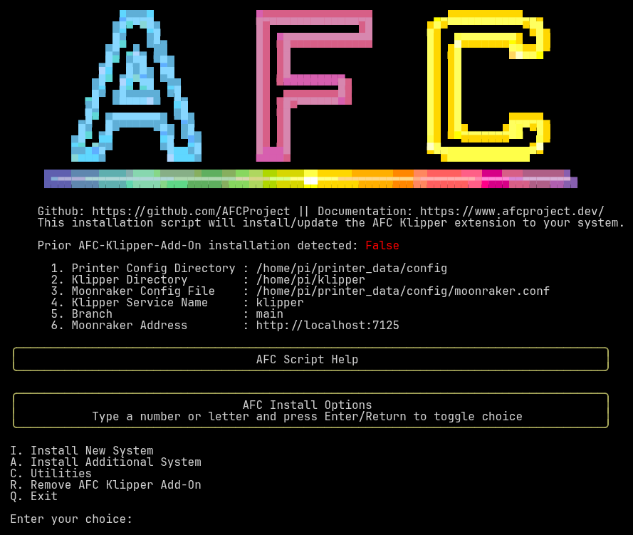
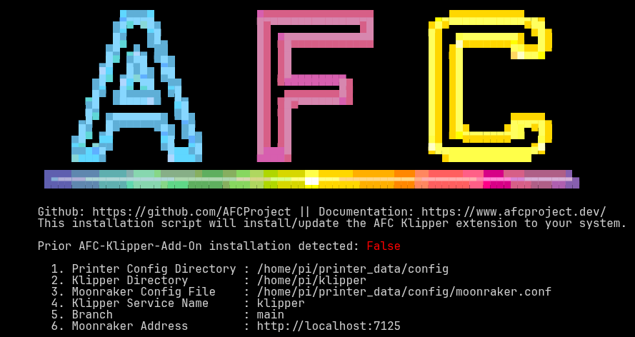
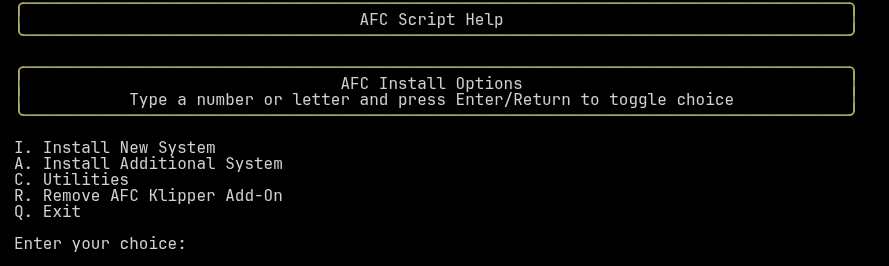

### Menu System

Each of our menus is designed to be user-friendly and easy to navigate. The menus are designed to be used with a keyboard,
and each option is preceded by a number or letter. Simply type the number or letter of the option you wish to select and 
press Enter. You will either be prompted for input, or the option will cycle through its available values.

### Menu Overview
When initially running the `install-afc.sh` script, you will be presented with the main menu after the
[startup checks](getting-started.md#what-happens-at-startup) complete. This menu will allow you to select the action
you wish to perform.

{ loading=lazy }

This menu is broken up into two main sections. The `top` section contains information about your system that was
gathered during the installation process, or set by the user using runtime options. 

{ loading=lazy }

#### Prior AFC-Klipper-Add-On installation detected

This value shows `True` if the script detects that the AFC-Klipper-Add-On software has been previously installed on your
system, and `False` otherwise. This is checking for the existence of a symbolic link in your Klipper extras directory to
the AFC-Klipper-Add-On software. It also changes to `True` after you install or update AFC during the current session.

#### Settings

The numbered rows below the installation status show the settings the installer is using. These come from the default
values or from the [runtime options](runtime-options.md) you started the script with.

| Row | Setting                 | Runtime option | Editable in the menu |
|-----|-------------------------|----------------|----------------------|
| 1   | Printer Config Directory | `-p`           | Yes                  |
| 2   | Klipper Directory        | `-k`           | Yes                  |
| 3   | Moonraker Config File    | `-m`           | Yes                  |
| 4   | Klipper Service Name     | `-s`           | Yes                  |
| 5   | Branch                   | `-b`           | No                   |
| 6   | Moonraker Address        | `-a` and `-n`  | Yes                  |

To change an editable setting, type its row number and press Enter. You will be asked for the new value. Leaving the answer
blank keeps the current value. The installer validates what you type and, if the value is not valid, keeps the old value
and tells you why:

- **Directories** (rows 1 and 2) must already exist. Changing the printer config directory also moves the Moonraker
  config file along with it, unless you have set the Moonraker config file to something else. Changing the Klipper directory
  re-checks whether AFC is already installed there.
- **Moonraker Config File** (row 3) may be a new file, but the folder it is in must exist.
- **Klipper Service Name** (row 4) may only contain letters, digits, and the characters `.` `_` `@` `:` `-`.
- **Moonraker Address** (row 6) is entered as `[http://|https://]host[:port]`. The scheme defaults to `http://` and the
  port is left unchanged if you do not enter one. The port must be a number from 1 to 65535.
- **Branch** (row 5) cannot be changed from the menu because changing branches requires the script to restart. Re-run the
  script with the `-b <branch>` option instead.

{ loading=lazy }

The `bottom` section of the main menu is dynamic, that is, the options provided will change based on the state of your system.

### Menu Options
The options available in the bottom section are as follows:

#### `I. Install New System`

This option will start the installation process for the AFC-Klipper-Add-On software. You will first choose the type of unit
you are installing, and then be walked through the options for that unit. See the [Install Menu](install-menu.md) page for details.

!!! note
    This option will only appear if a prior installation of the AFC-Klipper-Add-On software has not been detected. It is
    also hidden once you have installed AFC during the current session. If you need to make more changes after an install,
    quit and restart the script.

#### `U. Update AFC Klipper Add-On`

This option will take you to the update menu where you can update the AFC-Klipper-Add-On software on your system. See the
[Update Menu](update-menu.md) page for details.

!!! note
    This option will only appear if a previous installation of the AFC-Klipper-Add-On software has been detected.

#### `A. Install Additional System`

This option will help you install additional physical units into your system. An example of this would be a second
BoxTurtle unit to go from a total of 4 lanes to 8 lanes. Another example would be adding a NightOwl to a system with a previous
BoxTurtle or any combination thereof with supported system.

As with a first install, you will start by choosing the unit type. Each additional unit is named with the lowest free name
for its type (for example `Turtle_2`) unless you choose another name, and the installer will not allow a name that is
already in use. Unit types that support it will also ask whether the new unit has its own buffer or shares the buffer of an
existing unit.

!!! note
    This option is a `best-effort` option and will require knowledge of your system. You can expect to have to manually 
    configure the software after running this option. This option cannot be used until a first unit is installed. If you
    try, the installer will tell you to install your first unit from the main Install menu.

Further information is available on the [Additional Units](../additional-units/index.md) page.

#### `C. Utilities`

This option will provide you with various utilities to help manage your system. For example, if you want to rename 
an existing unit from `Turtle_1` (the default) to `Totally_Awesome_Turtle`, you can do so with this menu option. See the
[Utilities Menu](utilities-menu.md) page for details.

#### `R. Remove AFC Klipper Add-On`

This option will remove the AFC-Klipper-Add-On software from your system. A backup of your complete AFC system configuration
is created in your `~/printer_data/config` (default) directory prior to removal. The backup directory will 
be named in the format of `AFC.backup.<timestamp>`. See the [Uninstall Process](uninstall-process.md) page for details.

#### `Q. Exit`

This option will exit the script. If AFC was installed or updated during this session, the installer will restart Klipper
for you on the way out (see the note on [restarting Klipper](uninstall-process.md#restarting-klipper)).
