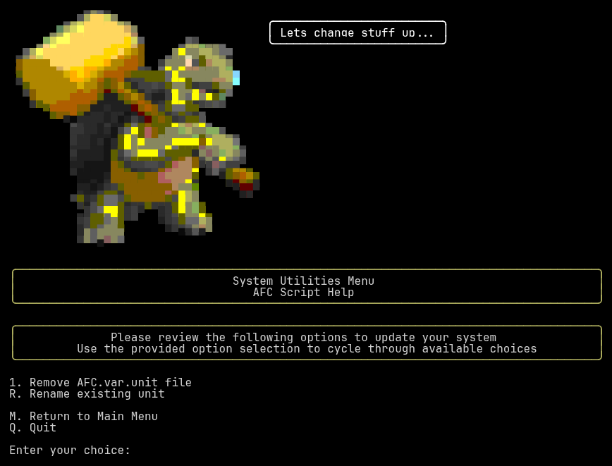

### Utilities Menu Overview

{ loading=lazy }

The `Utilities` menu allows you to change certain aspects of your system. It currently has two functions available to use.

### Menu Options

#### `1. Remove AFC.var.unit file`

This option deletes the `AFC.var.unit` file from your `AFC` configuration directory (typically `~/printer_data/config/AFC`).
This is generally a troubleshooting step and should not be needed during normal operation.

You will be asked to confirm with `y` before anything is removed. Any other answer cancels the operation. If the file does
not exist, you will be told that there was no file to remove.

#### `R. Rename existing unit`

This option will allow you to rename an existing unit. For example, by default, when you install a BoxTurtle system,
it is named `Turtle_1`. This value is displayed in the Mainsail/Fluidd GUI along with multiple places in the 
configuration files.

This option will prompt you for the following information:

{ loading=lazy }

    - Name of the unit you want to rename
    - New name of the unit

A validation check will be performed to ensure that the name meets specific requirements

??? note "Name Validation Requirements"

        The name may only contain the characters `a-z`, `A-Z`, `0-9`, `-`, and `_`
        (the regex `^[a-zA-Z0-9_-]+$`). It also must be no more than 24 characters in length.

Once the name is validated, the system will rename the unit and update the configuration files accordingly. 

#### `M. Return to Main Menu`

Select this option to return to the main menu.

#### `Q. Quit`

Select this option to exit the AFC script.
