# Toolhead Variable Calculation

This document describes how to calculate the toolhead variables in the AFC Klipper add-on. These variables are
crucial for ensuring that the toolhead operates correctly with the AFC system.


!!!note 
    The following documentation pertains to the use of a toolhead cutter primarily. While some of the information
    may be applicable if you are using tip-forming, our official recommendation is to use a toolhead
    cutter.

=== "Semi-Automated Calibration"
    ## Overview
    AFC can walk you through calibrating your toolhead in a semi-automated way. Before you begin, make sure a spool
    is loaded into a lane and your extruder is unloaded. To start, run `AFC_CALIBRATION` or choose `Calibration`
    from your UI AFC panel, then select `Toolhead Calibration` as seen below.

    <center>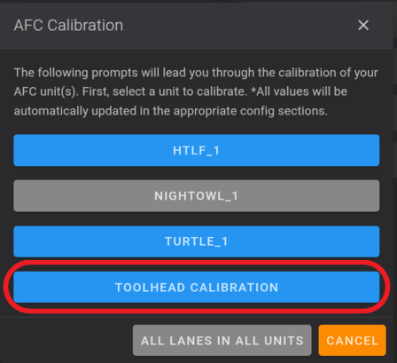</center>

    If you have more than one toolhead extruder configured, you'll be asked to select one:
    <center>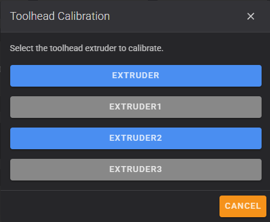</center>
    If more than one lane feeds that extruder, you'll then be asked to select a lane to calibrate with. This only
    needs to be done once per toolhead/extruder, not for every lane:
    <center>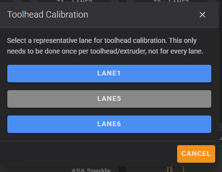</center>

    !!!note
        These selection prompts are skipped automatically when there's only one toolhead extruder, or only one
        lane feeding it.

    In the next prompt you can select from the following:

    - Tool STN: Guides you through finding this value by loading filament to the toolhead sensor, or to the
      toolhead's gears if using buffer ramming.
    - Cutter Retract: Guides you through finding how much to retract when cutting.
    - Tool STN Unload: Guides you through finding how much to retract after cutting to clear the toolhead sensor,
      or until filament is free from the gears.

    <center></center>

    If you don't see the Tool STN option, you need to unload your toolhead first.
    Suggested order: Tool STN, Cutter Retract, then Tool STN Unload.

    ## Calibration
    === "Tool STN"
        #### Select tool_stn
        To start Tool STN calibration, select the `tool_stn` button:
        <center>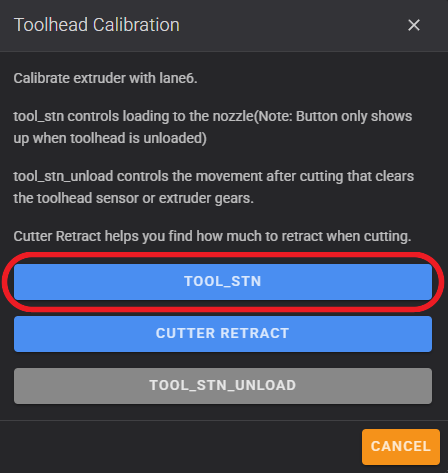</center>

        #### Load to the Toolhead
        AFC will then perform a normal load to your toolhead sensor, or to your gears if using buffer ramming.
        During this, AFC will show the status in prompts describing what's happening, such as heating the
        toolhead and then loading to the toolhead.
        <div class="image-row" markdown="1">
        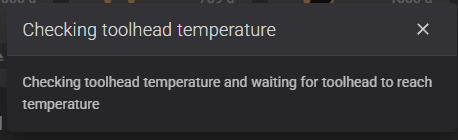
        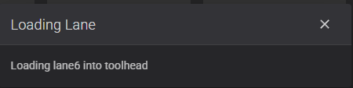
        </div>

        #### Fine-Tune and Save
        Once the lane is loaded to the toolhead sensor or gears, AFC will stop and display a prompt that lets you
        manually move the filament toward the nozzle. Use the move buttons until filament barely comes out of the
        nozzle.

        !!!note
            At any step, if you accidentally exit out of the prompt once started, run
            `AFC_TOOL_STN_CALIBRATION LANE=<lane_name>` to display the prompt again, or run
            `AFC_TOOL_STN_CALIBRATION LANE=<lane_name> CANCEL=1` to cancel the calibration.

        <center>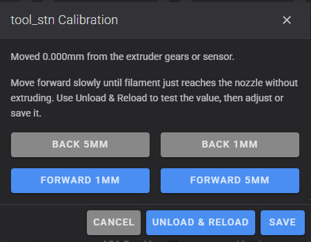</center>

        At this step you have two options: save and move on, or unload and reload to test the value first with the
        `Unload & Reload` button. This performs a normal unload/load cycle, including poop, brush, and kick if
        enabled, then reports back here so you can check the result: if an excessive amount of filament extrudes
        out, decrease the value; if no filament extrudes, increase it. Once you're satisfied with the result, hit
        `Save` and AFC will automatically update the `tool_stn` value for the selected extruder.

        !!!note
            A table of recommended starting values by toolhead/extruder combination is available
            [here](../initial-startup/06-hotend-values.md). It's a good sanity check if the value you land on
            looks far off from what's expected for your hardware.

        Once you hit save, a prompt will display the value that was saved. Hit `Done` to close the prompt.  
        <center>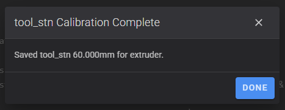</center>

        #### Example
        <center><video controls>
            <source src="../assets/images/toolhead_calibration/tool_stn/tool_stn_video_compressed.mp4" type="video/mp4">
            Your browser does not support the video tag.
        </video></center>

    === "Cutter Retract"
        #### Select Cutter Retract
        To start finding the cutter retract distance, select the `Cutter Retract` button:  
        <center>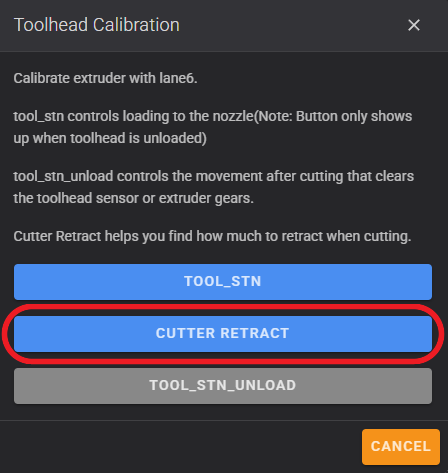</center>

        #### Load to the Toolhead
        If filament is not already loaded into your toolhead, AFC will first run through a full loading sequence,
        including poop, brush, and kick if enabled. Once loaded, the following prompt will appear:  
        <center>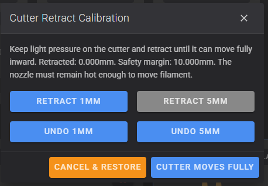</center>

        !!!note
            At any step, if you accidentally exit out of the prompt once started, run
            `AFC_CUTTER_CALIBRATION LANE=<lane_name>` to display the prompt again, or run
            `AFC_CUTTER_CALIBRATION LANE=<lane_name> CANCEL=1` to cancel the calibration.

        #### Retract and Save
        With your lane loaded to the toolhead, apply light pressure on the cutter and slowly retract. Once the
        cutter can be fully pressed in, filament has moved past it. One way to do this is to move a small amount,
        then press the cutter to check, repeating so you don't cause binding while retracting.

        Once you've retracted enough for the cutter to move its full motion, press the `Cutter Moves Fully` button.
        AFC will move the filament back to the nozzle by the same distance it was retracted, then save a
        `variable_retract_length` for your cut macro that is a configurable safety margin (10mm by default,
        set with the `MARGIN=` parameter) shorter than the distance you measured, so a small amount of filament
        is always left in the nozzle when cutting. Select `Done` to close the prompt.  
        <center>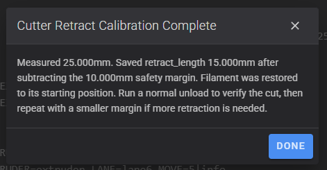</center>

        #### Example
        <center><video controls>
            <source src="../assets/images/toolhead_calibration/cutter_retract/cutter_retract_video_compressed.mp4" type="video/mp4">
            Your browser does not support the video tag.
        </video></center>
    === "Tool STN Unload"
        #### Select Tool STN Unload
        To start finding the Tool STN Unload distance, select the `Tool STN Unload` button:  
        <center>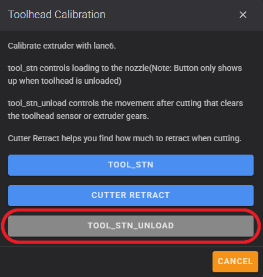</center>

        #### Load to the Toolhead
        If filament is not already loaded into your toolhead, AFC will first run through a full loading sequence,
        including poop, brush, and kick if enabled.

        !!!note
            At any step, if you accidentally exit out of the prompt once started, run
            `AFC_TOOL_STN_UNLOAD_CALIBRATION LANE=<lane_name>` to display the prompt again, or run
            `AFC_TOOL_STN_UNLOAD_CALIBRATION LANE=<lane_name> CANCEL=1` to cancel the calibration.

        !!!note
            This calibration requires a toolhead cutter to be enabled, since it works by cutting and then
            measuring the retraction needed to clear the toolhead.

        !!!note
            If your toolhead has the cutter above the extruder gears, `tool_stn_unload` should be `0` and this
            calibration isn't needed; the `Restore & Save` button below requires some amount of retraction before
            it will save, so it can't be used to set the value to `0`. Set it directly in your unit-specific
            config file instead.

        #### Cut and Retract
        Once that is done, AFC will display a prompt describing the next steps. Hitting `Cut & Begin` makes AFC
        call your cut macro:  

        <center>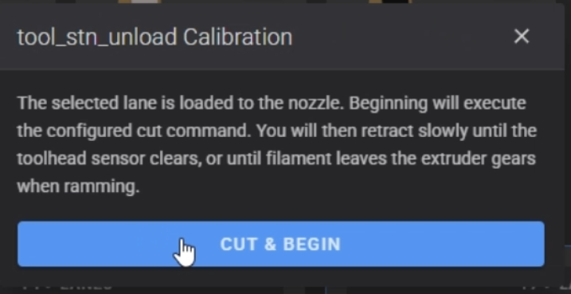</center>

        Once the cut macro finishes, AFC will display the following prompt:  
        <center>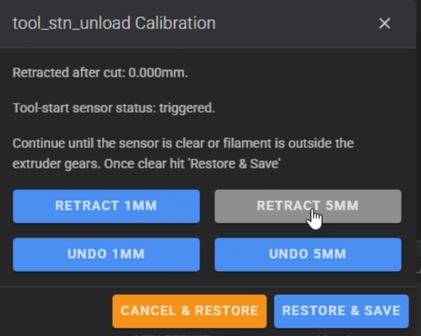</center>

        As shown in the screenshot, when using a filament sensor AFC displays the current status of the sensor.
        Retract until the status shows `clear`. When using ramming, retract until filament clears your toolhead
        extruder gears; you may need to remove the PTFE tube from your toolhead to tell when filament is clear of
        the gears.

        #### Save
        Once filament clears the sensor or gears, hit the `Restore & Save` button. AFC will move filament back
        toward the nozzle by the same amount it was retracted, and automatically update the `tool_stn_unload`
        variable for the selected extruder. If you removed your PTFE tube from the toolhead, reconnect it before
        selecting `Restore & Save`.

        #### Example
        <center><video controls>
            <source src="../assets/images/toolhead_calibration/tool_stn_unload/tool_stn_unload_compressed.mp4" type="video/mp4">
            Your browser does not support the video tag.
        </video></center>
=== "Manual Calibration Steps"

    These primarily consist of 2 variables:

    - `tool_stn`: The distance from the toolhead sensor (typically the pre-extruder sensor) or extruder gears (if using ramming) to the top of any filament
    remaining in the hotend. This has also been described as "sensor to nozzle". When this amount is loaded, your hotend should be full, but not yet extruding anything.
    - `tool_stn_unload`: The distance the toolhead needs to move to unload the filament.

    ### `tool_stn` Calculation

    The `tool_stn` variable is the distance from the toolhead sensor/top of extruder gears (ramming) to the top of any filament remaining in the hotend.
    This takes into account the amount of filament that is left in the hotend after the pushback and retract operations of
    the cut macro have been performed. 

    The easiest way to calculate this value is to start with a recommended value based on your toolhead/extruder combination.
    A table of common values is provided [here](../initial-startup/06-hotend-values.md).

    !!!note 
        It may be easier to temporarily disable the `AFC_POOP` macro while you are adjusting the `tool_stn` value, as this
        will provide an easier way to observe the filament extruding from the hotend. Run `AFC_TOGGLE_MACRO POOP=0` to 
        disable the macro, and `AFC_TOGGLE_MACRO POOP=1` to re-enable it after you have finished adjusting the value.

    Once you have a recommended value, fine-tune it by performing the following steps:

    1. Unload the filament completely from the toolhead. This can be done by using the `TOOL_UNLOAD LANE=<lane>` command in
    the Klipper console.  
    2. Load the filament into the toolhead using a toolchange command, such as `T1`.  
    3. Observe the filament to see if it is extruding out of the hotend. If an excessive amount of filament extrudes out, 
    you will need to decrease the `tool_stn` value. If no filament extrudes, you will need to increase the `tool_stn` value.  
    4. Repeat steps 1, 2 and 3 until you find a value that works for your toolhead/extruder combination.  

    Use the following command to adjust the `tool_stn` value without having to restart the system:

    ```
    UPDATE_TOOLHEAD_SENSORS EXTRUDER=<extruder> TOOL_STN=<length>
    ```

    Once you have found a value that works, save it to the configuration with the following command:

    ```
    SAVE_EXTRUDER_VALUES EXTRUDER=<extruder>
    ```

    !!!note
        Don't forget to re-enable the `AFC_POOP` macro by running `AFC_TOGGLE_MACRO POOP=1` after you have finished
        adjusting the `tool_stn` value if you disabled it earlier. 

    ### `tool_stn_unload` Calculation

    The `tool_stn_unload` variable is the distance that the filament moves when the toolhead is unloaded, after the cut macro
    is executed and any pushback and retract operations have been performed. If you have a toolhead with the cutter
    above the extruder gears, you should set this value to 0.

    Like adjusting the `tool_stn` value, start with a recommended value based on your toolhead/extruder combination 
    and use the following steps to fine-tune it:

    1. Completely load the filament into the toolhead using a toolchange command, such as `T1`. 
    2. Manually extrude filament until you observe it coming out of the hotend. This will help reduce the chances of
    a jam occurring during the unload operation.
    3. Manually execute the `AFC_CUT` macro to perform a cut operation.
    4. Using a manual extrude command, retract the filament by a set amount, until the toolhead sensor is no longer triggered.

        For example, if your estimated `tool_stn_unload` value is `62mm`, start by issuing a manual retraction for 55mm
        and then manually retracting 1mm at a time until the toolhead sensor is no longer triggered. If using ramming, retract until filament is out of the toolhead extruder gears.

    5. Once you have found the value that works, save it to the configuration with the following command:

    ```
    UPDATE_TOOLHEAD_SENSORS EXTRUDER=<extruder> TOOL_STN_UNLOAD=<length>
    SAVE_EXTRUDER_VALUES EXTRUDER=<extruder>
    ```